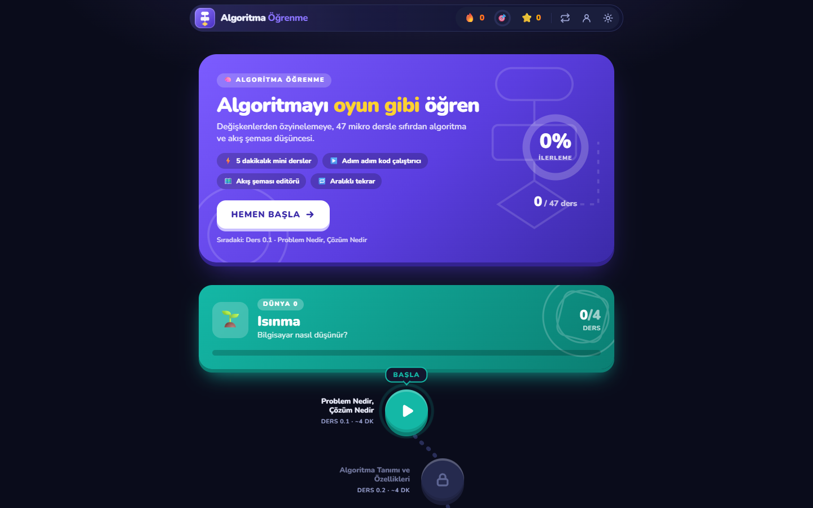
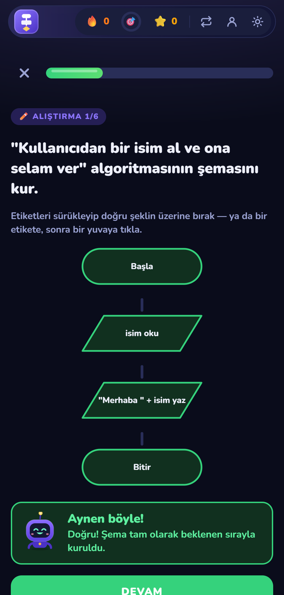
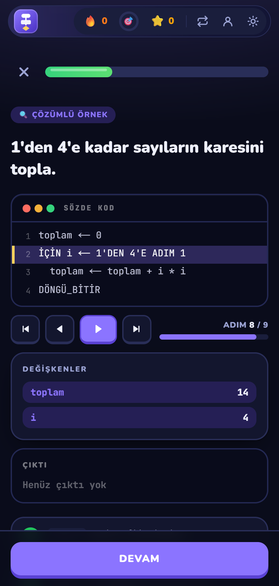
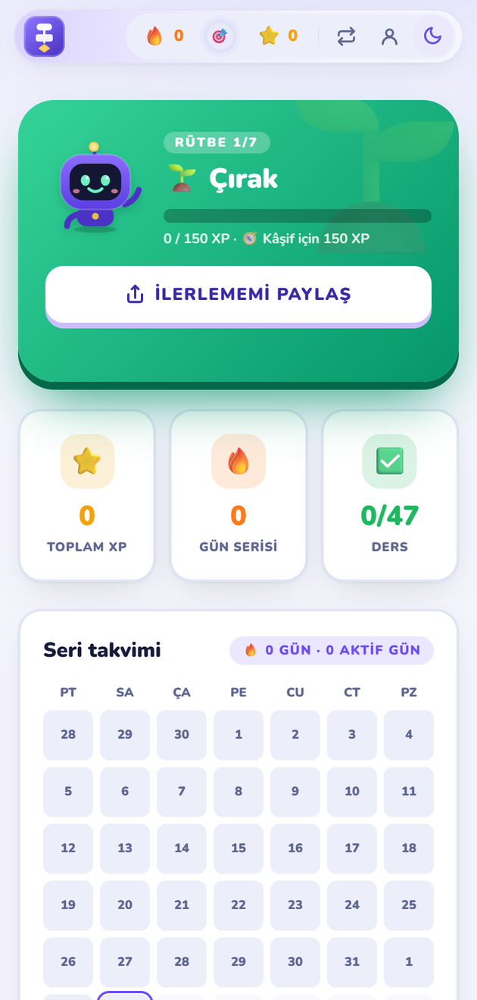
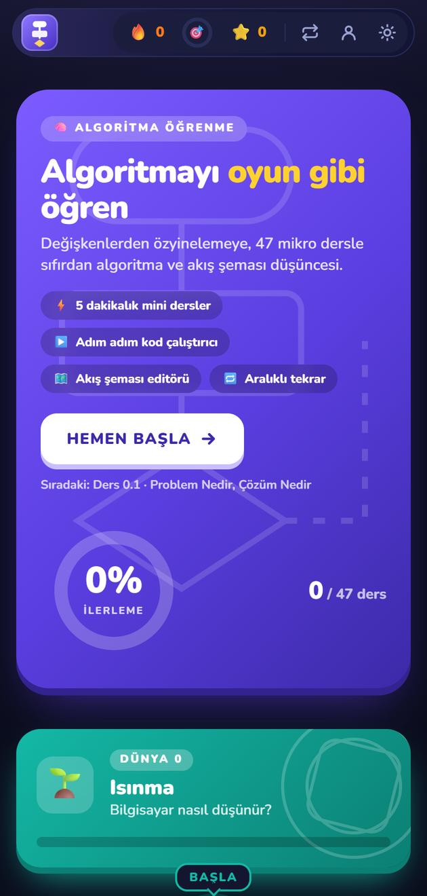
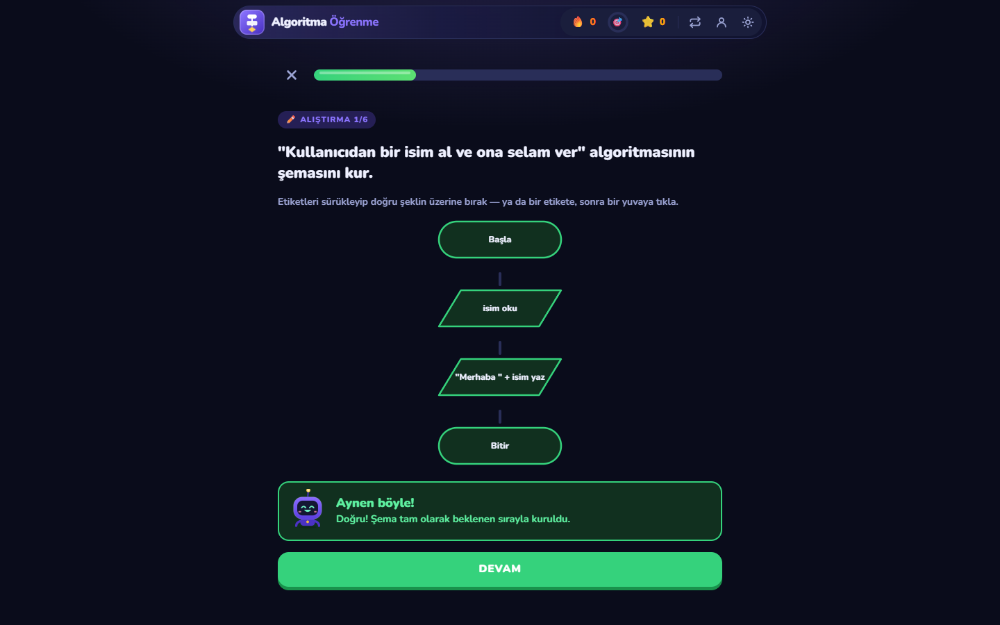
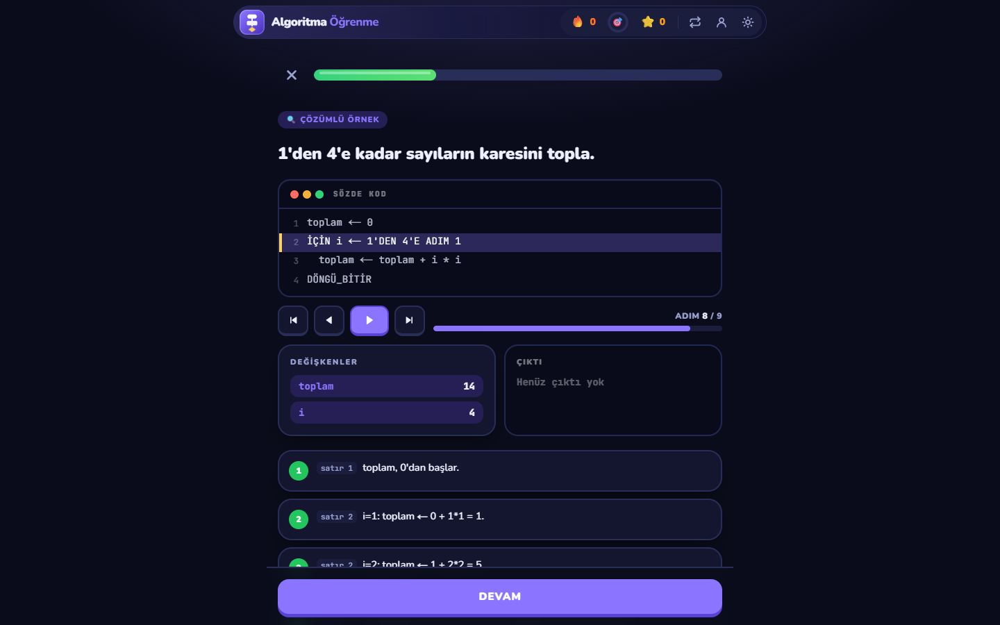
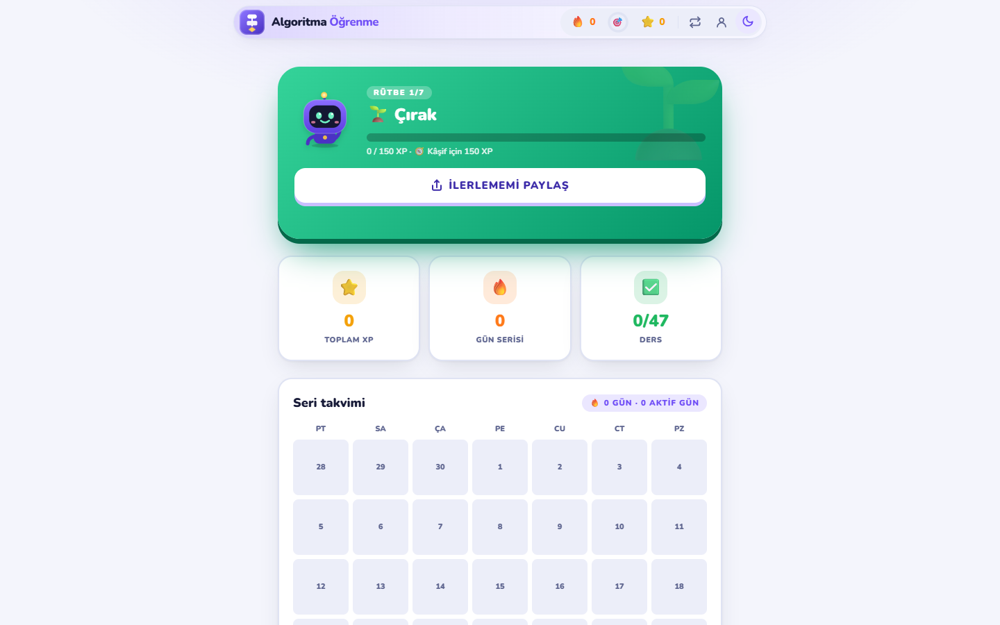

<div align="center">

# Algorithm Learning

**A web app that teaches algorithms, flowcharts and pseudocode through short, Duolingo-style lessons.**

[🇹🇷 Türkçe](README.tr.md) · 🇬🇧 English

[**Live demo →**](https://halisdalkilic.github.io/algoritma-ogrenme/en/) &nbsp;·&nbsp; [Türkçe sürüm →](https://halisdalkilic.github.io/algoritma-ogrenme/)




</div>

## Overview

Learners progress through 7 "worlds" and 47 lessons; each lesson combines short concept explanations with exercises.
Correct answers earn XP and ranks, and mistakes come back through spaced repetition (after 1 / 3 / 7 days). The app is
available in **Turkish and English**. No account is needed: progress is stored in the browser. Optionally, learners can
create an account with an email and a password to sync their progress between a phone and a computer.

## Features

- **9 exercise types:** multiple choice, fill in the blank, ordering, output prediction, trace table, pseudocode
  writing, flowchart reading, and drag-and-drop flowchart building
- **Pseudocode interpreter:** tokenizer → parser (AST) → interpreter; runs code step by step and shows the variables
- **Concept animations:** sorting and searching steps are generated from the real algorithm, not drawn by hand
- **Forgiving answer checking:** letter case, ASCII in place of Turkish characters (`dogru`, `EGER`) and quote style
  are not counted as mistakes
- **Two languages:** all 47 lessons in Turkish (`/`) and English (`/en`). English pseudocode mirrors the Turkish one
  (`IF` / `END`, `FOR` / `END_LOOP`); the code runner executes both
- **Motivation:** mascot "Algo", streak calendar, daily goal, ranks, a shareable achievement card
- **Optional account:** cross-device sync; saves are validated on the server and fake XP or streaks are rejected ([setup](KURULUM.md), in Turkish)
- **PWA and accessibility:** works offline, light/dark theme, screen reader announcements, touch dragging, 44px touch targets

## Screenshots

<table>
  <tr>
    <td align="center"><br><sub>Building a flowchart</sub></td>
    <td align="center"><br><sub>Code runner</sub></td>
    <td align="center"><br><sub>Profile (light theme)</sub></td>
    <td align="center"><br><sub>Mobile view</sub></td>
  </tr>
</table>

<details>
<summary>Desktop views</summary>
<br>





</details>

## Tech overview

| Layer | Technology |
|---|---|
| UI | Next.js 16 (App Router, static export), React 19, TypeScript |
| Styling and motion | Tailwind CSS 4, Framer Motion, dnd-kit (drag and drop) |
| State | Zustand; progress lives in `localStorage` and syncs to the cloud when an account is on |
| Content | JSON lessons validated with Zod schemas; adding a lesson needs no code |
| Account (optional) | Supabase Auth + Postgres, row-level security (RLS), a `save_progress()` validation function |
| Testing | Vitest, 433 unit tests: content integrity, translation parity, the interpreter, merge logic |
| Deployment | GitHub Actions → GitHub Pages |

Only the public key is embedded in the browser; data safety is enforced by rules in the database.

## Project structure

```
app/            Pages: (tr) map, /ders/[id], /tekrar, /profil, /gizlilik · (en) /en/...
components/     Exercises, flowchart, code runner, animations, mascot, account panel
content/        Lessons: worlds/ (Turkish) and en/ (English); parity tests compare the two
lib/            Scoring, spaced repetition, badges/ranks, progress store, i18n, SEO, account and sync
supabase/       Database schema and server-side validation (for the optional account)
docs/i18n/      Translation glossary and style guide
```

## Getting started

```bash
npm install
npm run dev        # http://localhost:3000  (English: /en)
npm test           # unit tests
npm run lint:text  # spelling and style checks (Turkish + English)
npm run build      # static site into out/
```

The account feature is off by default; see [KURULUM.md](KURULUM.md) (in Turkish) to enable it.
Every push to `main` is tested by GitHub Actions and published to GitHub Pages.

## License

All rights reserved. The source code may be viewed; it may not be used, copied or distributed without permission. See [LICENSE](LICENSE).
