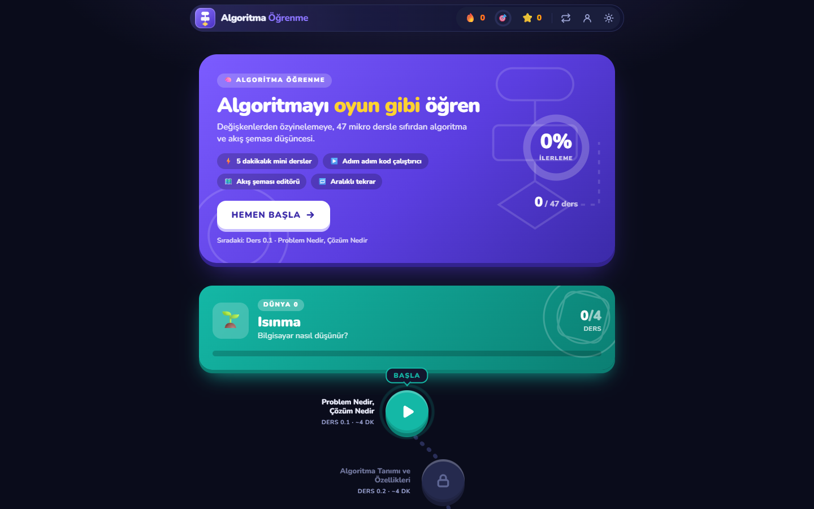
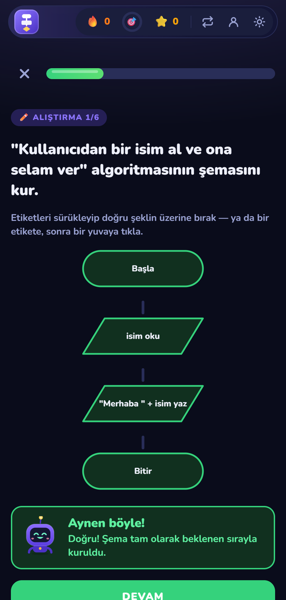
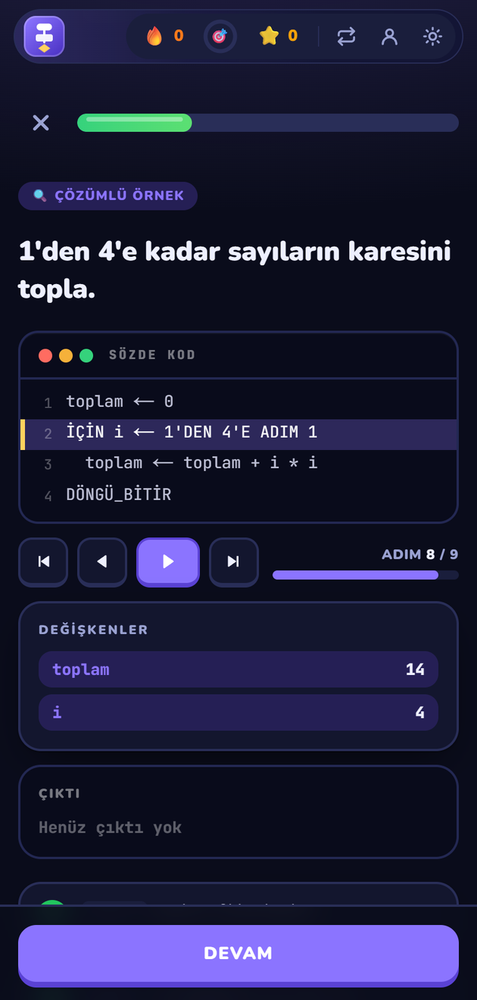
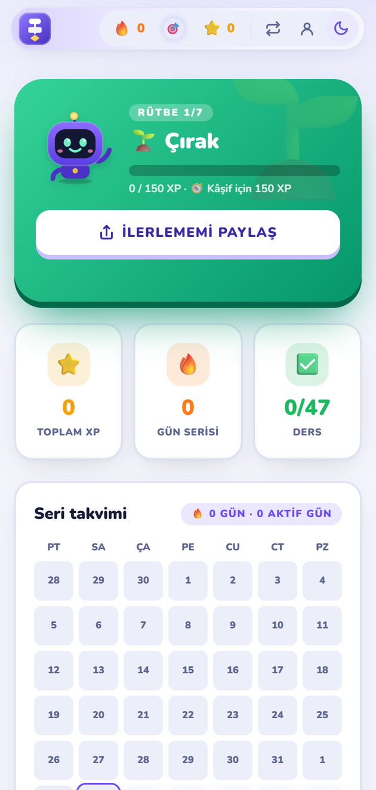
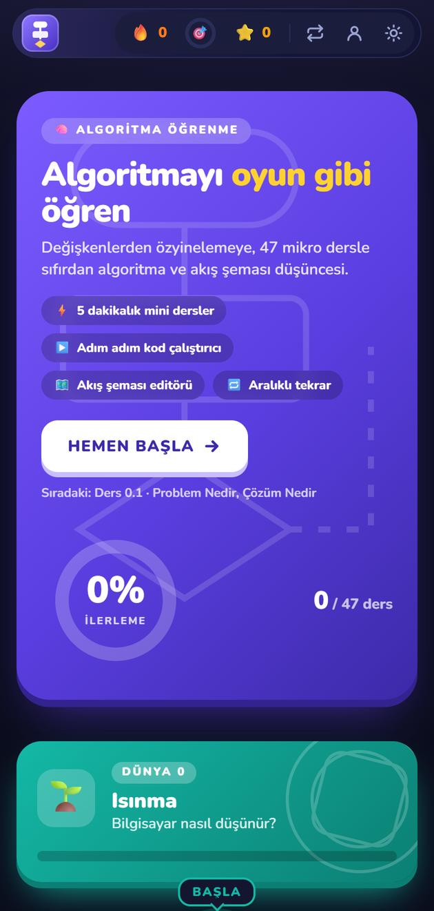
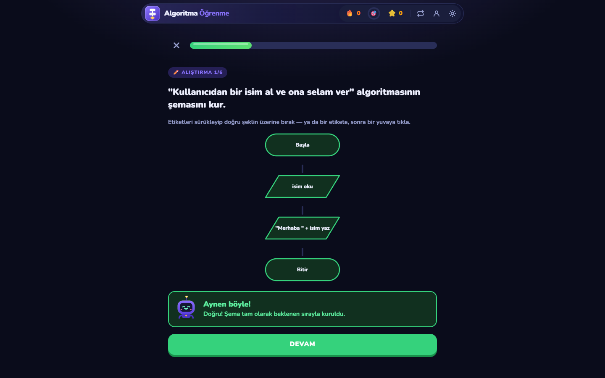
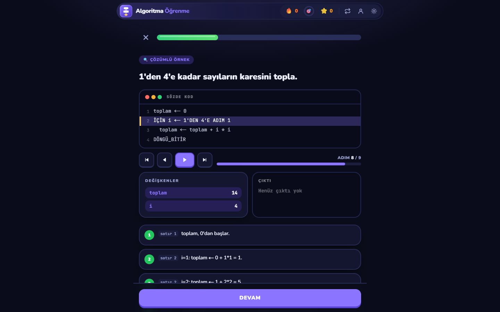
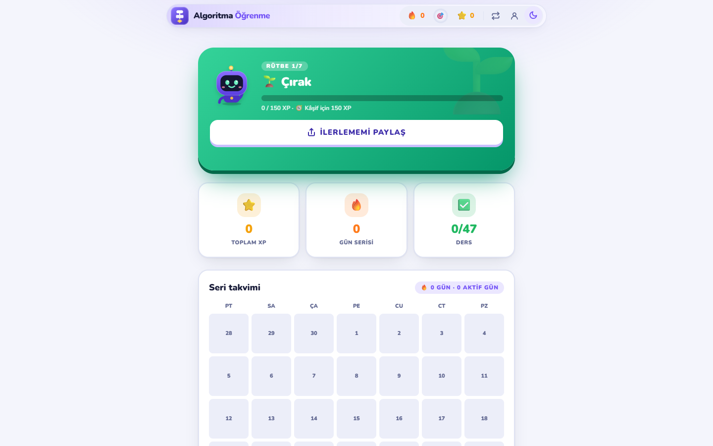

<div align="center">

# Algoritma Öğrenme

**Duolingo tarzı mikro derslerle algoritma, akış şeması ve sözde kod öğreten web uygulaması.**

🇹🇷 Türkçe · [🇬🇧 English](README.md)

[**Canlı demo →**](https://halisdalkilic.github.io/algoritma-ogrenme/) &nbsp;·&nbsp; [English version →](https://halisdalkilic.github.io/algoritma-ogrenme/en/)




</div>

## Genel bakış

7 "dünya" ve 47 ders boyunca ilerlenir; her ders kısa kavram anlatımları ve alıştırmalardan oluşur. Doğru cevaplar XP
ve rütbe kazandırır, yanlış cevaplar aralıklı tekrarla (1 / 3 / 7 gün) geri gelir. Uygulama **Türkçe ve İngilizce**
sunulur. Hesap gerekmez; ilerleme tarayıcıda saklanır. İsteyen, e-posta ve şifreyle hesap açıp telefon ile bilgisayar
arasında ilerlemesini eşitleyebilir.

## Özellikler

- **9 alıştırma tipi:** çoktan seçmeli, boşluk doldurma, sıralama, çıktı tahmini, iz tablosu, sözde kod yazma, akış
  şeması okuma ve sürükle-bırak ile akış şeması kurma
- **Sözde kod yorumlayıcısı:** tokenizer → parser (AST) → interpreter; kodu adım adım çalıştırıp değişkenleri gösterir
- **Kavram animasyonları:** sıralama ve arama adımları sabit çizim değil, gerçek algoritmadan üretilir
- **Hoşgörülü cevap kontrolü:** büyük/küçük harf, Türkçe karakter yerine ASCII (`dogru`, `EGER`) ve tırnak farkı
  yanlış sayılmaz
- **İki dil:** 47 dersin tamamı Türkçe (`/`) ve İngilizce (`/en`). İngilizce sözde kod Türkçe olanın aynadaki
  karşılığıdır (`IF` / `END`, `FOR` / `END_LOOP`); kod çalıştırıcı ikisini de çalıştırır
- **Motivasyon:** maskot "Algo", seri takvimi, günlük hedef, rütbeler, paylaşılabilir başarı kartı
- **İsteğe bağlı hesap:** cihazlar arası senkron; kayıtlar sunucuda doğrulanır, sahte XP ve seri reddedilir ([kurulum](KURULUM.md))
- **PWA ve erişilebilirlik:** çevrimdışı çalışır, açık/koyu tema, ekran okuyucu duyuruları, dokunmatik sürükleme, 44px dokunma hedefleri

## Ekran görüntüleri

<table>
  <tr>
    <td align="center"><br><sub>Akış şeması kurma</sub></td>
    <td align="center"><br><sub>Kod çalıştırıcı</sub></td>
    <td align="center"><br><sub>Profil (açık tema)</sub></td>
    <td align="center"><br><sub>Mobil görünüm</sub></td>
  </tr>
</table>

<details>
<summary>Masaüstü görünümler</summary>
<br>





</details>

## Teknik yapı

| Katman | Teknoloji |
|---|---|
| Arayüz | Next.js 16 (App Router, statik export), React 19, TypeScript |
| Stil ve animasyon | Tailwind CSS 4, Framer Motion, dnd-kit (sürükle-bırak) |
| Durum | Zustand; ilerleme `localStorage`'da tutulur, hesap açıksa buluta eşitlenir |
| İçerik | JSON dersler, Zod şemasıyla doğrulanır; yeni ders eklemek kod gerektirmez |
| Hesap (isteğe bağlı) | Supabase Auth + Postgres, satır düzeyi güvenlik (RLS), `save_progress()` doğrulama fonksiyonu |
| Test | Vitest, 433 birim testi: içerik bütünlüğü, çeviri eşliği, yorumlayıcı, birleştirme mantığı |
| Yayın | GitHub Actions → GitHub Pages |

Tarayıcıya yalnızca herkese açık anahtar gömülür; veri güvenliği veritabanındaki kurallarla sağlanır.

## Proje yapısı

```
app/            Sayfalar: (tr) harita, /ders/[id], /tekrar, /profil, /gizlilik · (en) /en/...
components/     Alıştırmalar, akış şeması, kod çalıştırıcı, animasyonlar, maskot, hesap paneli
content/        Dersler: worlds/ (Türkçe) ve en/ (İngilizce); eşlik testleri iki dili karşılaştırır
lib/            Puanlama, aralıklı tekrar, rozet/rütbe, ilerleme store'u, i18n, SEO, hesap ve senkron
supabase/       Veritabanı şeması ve sunucu doğrulaması (isteğe bağlı hesap için)
docs/i18n/      Çeviri sözlüğü ve üslup rehberi
```

## Çalıştırma

```bash
npm install
npm run dev        # http://localhost:3000  (İngilizce: /en)
npm test           # birim testleri
npm run lint:text  # yazım ve üslup denetimi (Türkçe + İngilizce)
npm run build      # out/ klasörüne statik site
```

Hesap özelliği varsayılan olarak kapalıdır; açmak için [KURULUM.md](KURULUM.md) dosyasına bakın.
`main` dalına yapılan her push, GitHub Actions ile test edilip GitHub Pages'te yayınlanır.

## Lisans

Tüm hakları saklıdır. Kaynak kod incelenebilir; izinsiz kullanılamaz, kopyalanamaz veya dağıtılamaz. Ayrıntılar: [LICENSE](LICENSE).
